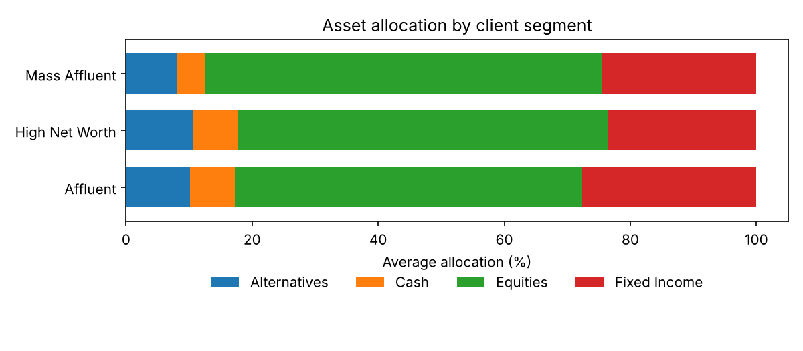

# Wealth Management ETL Pipeline


An ETL pipeline for wealth-management data that does what advisor-platform data actually needs: **clean messy source extracts, prove the numbers tie out, and turn them into client-level insight** (allocation, flows, fees and rebalancing flags), all loaded into SQLite with a full data-quality audit trail.

All data is synthetic.

## Pipeline

| Stage | What happens |
|---|---|
| **Extract** | Clients, accounts and holdings from CSV; transactions from a JSON custodian feed |
| **Clean** | Normalize name casing and whitespace, segment and account-type labels; drop duplicate holdings; remove transactions for unknown accounts. Every action is written to `data_quality_log` |
| **Validate** | Tie each account's balance to the sum of its holdings; mismatches over $1 go to `balance_breaks` |
| **Transform** | Per client: total assets, asset allocation %, contributions/withdrawals/dividends/fees, net flows, fee rate in bps, and **equity drift** against an age-based glide path (110 − age, bounded 20–90%) with a rebalance flag beyond ±10 pts |
| **Load** | All tables into `build/wealth.db`, plus `wealth_report.csv` and an allocation chart |

The generator deliberately injects realistic defects (inconsistent casing, missing ages, duplicate rows, holdings that don't tie) so the cleaning and validation steps have something real to catch:

```
Clients: 40 | AUM: $21,365,518 | Rebalance flags: 11 | Balance breaks: 3

   table                                              check  rows_affected
 clients                  normalized name casing/whitespace              3
 clients                    normalized wealth_segment label              1
 clients missing age (kept, excluded from glide-path check)              2
accounts                            normalized account_type              2
holdings                       removed exact duplicate rows              3
accounts         balance does not tie to holdings (> $1.00)              3
```



## Quick start

```bash
git clone https://github.com/RTorres1980/wealth-etl-project.git
cd wealth-etl-project
pip install -r requirements.txt

python generate_data.py      # optional: sample data is included (--clients, --seed)
python etl_pipeline.py
```

`sql/sample_queries.sql` has ready-made queries against `build/wealth.db`: AUM by segment, clients needing rebalancing, net new money by month, and balance breaks.

## Tests

```bash
pytest -q
```

Covers each cleaning rule, the balance tie-out, allocation/fee/drift calculations, and a full end-to-end run into SQLite.

## Project layout

```
generate_data.py        Synthetic CSV + JSON sources with injected defects
etl_pipeline.py         Extract → clean → validate → transform → load
sql/sample_queries.sql  Analysis queries for the SQLite output
build/                  Report CSV, data-quality log, chart (database is git-ignored)
tests/                  Unit and end-to-end tests
```

## Author

Robert Torres · [LinkedIn](https://www.linkedin.com/in/robert-torres-394535381) · [GitHub](https://github.com/RTorres1980)
